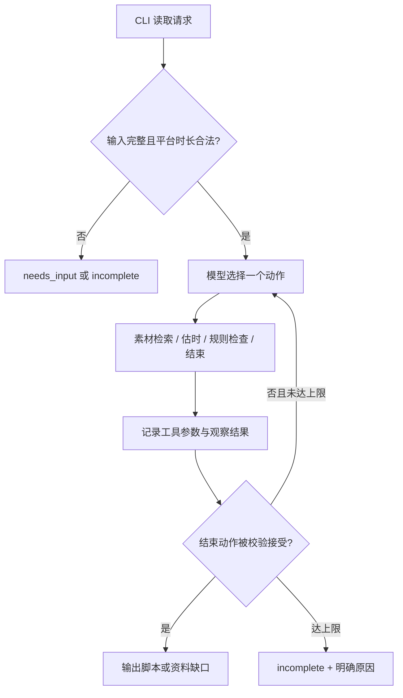

# 02 方案与决策

## 调用流程

真实模式每回合向 DeepSeek `chat/completions` 提供函数定义和之前的工具结果；模型必须选择 **一个** 动作。并行函数调用被拒绝并反馈给模型，以保证估时与规则检查之间存在真实的观察机会。Trace 的 `decision_basis` 是模型提供的简短可审查依据，不是内部思维过程。离线 `MockPolicy` 是显式标注的预设策略，仅用于验证流程，不作为模型 ReAct 成绩。

## 动态分支与边界

- 检索为空：模型可改写查询再次检索，或请求补充素材；`finish(needs_material)` 只在成功检索且无结果时接受。
- 首稿估时超限：模型修改分镜后重新调用 `estimate_duration`。不同草稿有不同的内容哈希 `script_id`；旧草稿的规则检查不能替新草稿背书。
- 规则工具失败：错误作为观察结果返回；模型可重试同一草稿或停止。检查发现无依据声明时，要修改脚本、再估时、再检查。
- `finish(complete)` 由业务工具核验同一草稿的估时和规则结果；未通过则拒绝。调用步数默认最多 12，业务工具最多 10 次，超限返回明确 `incomplete`。

## 估时与事实核查

每镜头的估时取 `max(计划秒数, ceil(旁白字符数/语速), ceil(字幕字符数/展示速率), 最小镜头秒数)`，按顺序累加。规则工具读取已冻结的草稿，逐条核对素材 ID、事实 ID、原文、检索来源和原文在该镜头旁白/字幕中的出现；检测无引用的“支持…”能力、无事实依据的百分比/倍数、禁用绝对化词及典型无依据功能词。最终脚本连同每镜头估时与引用一并交付。

## 技术取舍

原生 Python 标准库实现 CLI、JSON 数据与 DeepSeek 函数调用，减少安装成本，并让模型决策与业务工具的职责清晰可见。素材检索使用合成数据别名匹配；规则工具是可复现的程序校验。真实模型负责下一步动作与脚本草拟，程序负责硬性验收。未选用 Agent 框架，因此没有框架版本或隐藏流程；模型端点与模型名可由环境配置。
